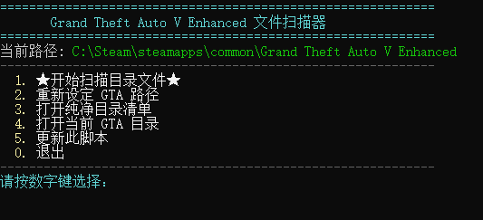

<div align="center">
  <strong style="font-size: 2em;">Grand Theft Auto V Enhanced File Scanner</strong><br>
  <span style="font-size: 1em; font-weight: normal;">GTA5增强版文件扫描仪</span>
  <br><br>
  
  <a href="#"></a>
  
</div>


### 通过对比纯净文件清单，快速检测并清除 GTA V Enhanced 游戏目录下的 Mod、外挂、残留文件及高风险项，助你安全进入线上模式


## ✨ 主要功能

- 🔍 **目录对比**：快速对比本地游戏目录与官方干净文件列表（`GTA-Directory.txt`）。
- 🚨 **风险识别**：智能识别常见的 `.asi`、`scripthook`、`menyoo` 等高风险文件。
- 🗑️ **一键清理**：支持删除所有多余文件或一键清理高风险项，自动记录删除日志（`deleted_files_log.txt`）。



## 📚 环境依赖
- **Python 3.10+**

## ⬇️ 下载项目
```bash
gh repo clone NeetheCheeBao/GTA5EE-FS
```

```bash
git clone https://github.com/NeetheCheeBao/GTA5EE-FS.git
```

## 🚀 运行脚本

```bash
python GTA5EE-fscan.py
```

或者

```text
直接双击 “GTA5EE-fscan.py” 运行
```

> [!IMPORTANT]
> ### 自行创建 `GTA-Directory.txt` 目录清单
>
> 1.打开GTA5增强版目录
>
> 2.在目录下打开命令行（CMD）
>
> 3.运行以下命令
>
> ```cmd
> (echo Grand Theft Auto V Enhanced & tree /a /f | more +3 | findstr /v /i "GTA-Directory.txt") > GTA-Directory.txt
> ```
>
> 4.将 `GTA-Directory.txt` **剪切** 到 `GTA5EE-fscan.py` 同级目录

## ⚖️ 许可证

本项目采用 MIT 许可证 - 详情请参阅 [LICENSE](LICENSE) 文件。