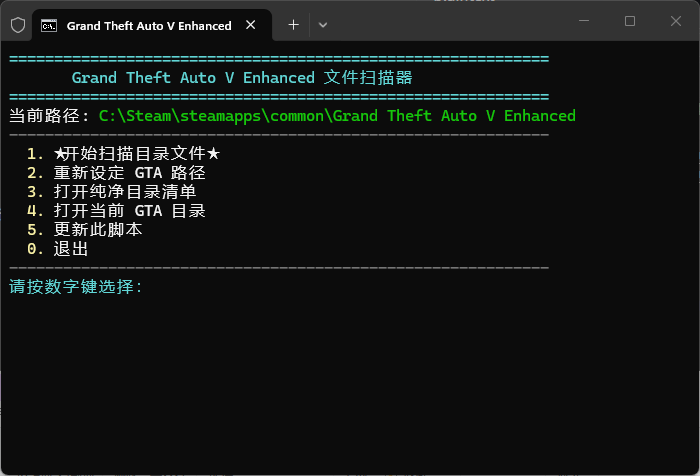
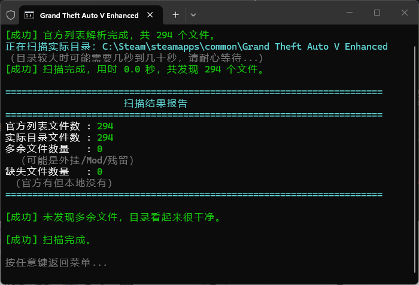

<h1 align="center">Grand Theft Auto V Enhanced File Scanner</h1>
<h3 align="center">GTA5增强版文件扫描仪</h3>
<p align="center">
  
  
  
</p>

> [!NOTE]
> 通过对比纯净文件清单，快速检测并清除 GTA V Enhanced 游戏目录下的 Mod、外挂、残留文件及高风险项，助你安全进入线上模式

## ✨ 主要功能

- 🔍 **目录对比**：快速对比本地游戏目录与官方干净文件列表（`GTA-Directory.txt`）。
- 🚨 **风险识别**：智能识别常见的 `.asi`、`scripthook`、`menyoo` 等高风险文件。
- 🗑️ **一键清理**：支持删除所有多余文件或一键清理高风险项，自动记录删除日志（`deleted_files_log.txt`）。

## 📷 演示

| 主界面 | 扫描结果 |
| --- | --- |
|  |  |

## 📚 环境依赖
- **Windows 10 / 11**（系统自带 PowerShell 5.1，开箱即用）

## ⬇️ 下载项目
```bash
gh repo clone NeetheCheeBao/GTA5EE-FS
```

```bash
git clone https://github.com/NeetheCheeBao/GTA5EE-FS.git
```

## 🚀 运行脚本

1. 方式1

双击 `GTA5EE-FileScanner.bat` 即可

2. 方式2

```bash
.\GTA5EE-FileScanner.bat
```

> [!NOTE]
> 首次运行会让你填写 GTA V Enhanced 的安装目录，之后会记录在 `GTA-Path.ini` 中。

> [!TIP]
> ### 自行创建 `GTA-Directory.txt` 目录清单
>
> 1.打开GTA5增强版目录
>
> 2.在目录下打开命令行（CMD）
>
> 3.运行以下命令
>
> ```cmd
> (echo Grand Theft Auto V Enhanced & tree /a /f | more +3 | findstr /v /i "GTA-Directory.txt") > GTA-Directory.txt
> ```
>
> 4.将 `GTA-Directory.txt` **剪切** 到 `GTA5EE-FileScanner.bat` 同级目录

## ⚖️ 许可证

本项目采用 MIT 许可证 - 详情请参阅 [LICENSE](LICENSE) 文件。